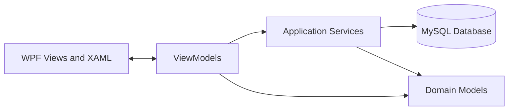

# Business Management System


A complete desktop management application built to centralize and simplify daily business operations.

This project represents more than a collection of screens and CRUD operations. It was an opportunity to transform an initial database into a structured application, make thoughtful technical decisions, and connect database design, software architecture, security, and user experience in one practical solution.

The interface is currently available in Portuguese.

## Table of Contents

- [About the Project](#about-the-project)
- [Main Features](#main-features)
- [Technology Stack](#technology-stack)
- [Architecture](#architecture)
- [Security](#security)
- [Database](#database)
- [Project Structure](#project-structure)
- [Getting Started](#getting-started)
- [What I Learned](#what-i-learned)
- [Future Improvements](#future-improvements)
- [License](#license)

## About the Project

The main goal of this application is to replace disconnected or manual processes with a single system where users can manage customers, suppliers, employees, products, stock, sales, and administrator accounts.

The original database structure was reviewed and migrated from Microsoft Access to MySQL. The application was then developed in C# with WPF and XAML, following the MVVM architecture to keep the interface, business logic, and data access responsibilities separated.

Particular attention was given to creating a desktop interface that feels clear and consistent during repeated use. The application includes reusable controls, responsive layouts, accessible form elements, validation feedback, adaptable data tables, and a unified visual system.

## Main Features

- Secure login and session management
- First-run administrator account creation
- Administrator account creation, editing, activation, and deletion
- Customer management
- Supplier management
- Employee management
- Product and stock management
- Sales registration with multiple product lines
- Automatic stock updates after each sale
- Dashboard with relevant business information
- Search and status filters
- Responsive tables and forms for different window sizes
- Reusable and accessible WPF control styles
- Fictitious sample data for local testing

## Technology Stack

| Area | Technologies |
| --- | --- |
| Language | C# |
| Desktop UI | WPF and XAML |
| Framework | .NET Framework 4.7.2 |
| Architecture | MVVM |
| Database | MySQL |
| Data access | MySql.Data and parameterized SQL commands |
| Security | PBKDF2 with SHA-256, individual salts, and constant-time hash comparison |
| Original database | Microsoft Access |
| Development environment | Visual Studio |

## Architecture

The project follows the MVVM pattern and separates each responsibility into dedicated folders.



- **Models** represent the application entities and data structures.
- **Views** contain the visual interface and responsive WPF layouts.
- **ViewModels** manage state, validation, commands, filtering, and presentation logic.
- **Services** contain database access, authentication, dashboard queries, and dialogs.

## Security

Passwords are never stored directly in the database.

Each password is protected using PBKDF2 with SHA-256, an individual random salt, and 100,000 iterations. Authentication also uses a constant-time comparison to reduce timing-based attacks.

The account management system includes additional safeguards:

- The currently authenticated account cannot delete or deactivate itself.
- The application cannot be left without an active administrator account.
- Inactive accounts cannot authenticate.
- SQL commands use parameters instead of building queries from user input.

## Database

The MySQL structure includes the following main entities:

- `Cliente`
- `Fornecedor`
- `Funcionario`
- `Produto`
- `Venda`
- `VendaLinha`
- `Utilizador`

Relationships, foreign keys, unique constraints, validation constraints, and delete/update rules are defined in the schema.

The repository includes:

- [`criar_base_dados_mysql.sql`](criar_base_dados_mysql.sql) to create the database structure.
- [`dados_teste_mysql.sql`](dados_teste_mysql.sql) with entirely fictitious data for testing.
- [`criar_base_dados_access.sql`](criar_base_dados_access.sql) as a reference to the original Access structure.

Local database files are intentionally excluded from the repository.

## Project Structure

```text
BusinessManagementSystem/
|-- Assets/                 # Application logo and icon
|-- Models/                 # Domain entities
|-- Properties/             # Assembly and application resources
|-- Services/               # Database and authentication services
|-- ViewModels/             # MVVM presentation logic
|-- Views/                  # WPF pages and code-behind for view concerns
|-- App.xaml                # Shared resources and application styles
|-- App.config              # Runtime and local database configuration
|-- LoginWindow.xaml        # Authentication window
|-- MainWindow.xaml         # Main navigation shell
|-- criar_base_dados_mysql.sql
|-- dados_teste_mysql.sql
`-- BusinessManagementSystem.sln
```

## Getting Started

### Prerequisites

- Windows 10 or Windows 11
- Visual Studio with the **.NET desktop development** workload
- .NET Framework 4.7.2 Developer Pack
- MySQL Server or XAMPP with MySQL
- NuGet package restore enabled

### Installation

1. Clone the repository:

   ```bash
   git clone https://github.com/marco-bertolo/wpf-business-management-system.git
   cd wpf-business-management-system
   ```

2. Create the MySQL database:

   ```bash
   mysql -u root -p < criar_base_dados_mysql.sql
   ```

3. Optionally insert the fictitious sample data:

   ```bash
   mysql -u root -p PAPJoao < dados_teste_mysql.sql
   ```

4. Update the `PAPJoao` connection string in `App.config` if your MySQL credentials are different:

   ```xml
   <add name="PAPJoao"
        connectionString="Server=localhost;Port=3306;Database=PAPJoao;Uid=root;Pwd=YOUR_PASSWORD;"
        providerName="MySql.Data.MySqlClient" />
   ```

5. Open `BusinessManagementSystem.sln` in Visual Studio.

6. Restore the NuGet packages, build the solution, and run the application.

7. On the first execution, the application will ask you to create the first administrator account.

## What I Learned

This project allowed me to work across different areas of software development instead of focusing on only one part of the application.

I improved my knowledge of WPF, XAML, MVVM, relational database design, SQL, authentication, password security, responsive desktop layouts, reusable styles, validation, and state management.

It also reminded me that building software is not only about making features work. It is about understanding a problem, organizing information correctly, protecting user data, and creating something that people can use with confidence.

There is always more to improve and learn, but seeing the project grow from an initial database into a complete management application has been a very meaningful experience.

## Future Improvements

- Automated unit and integration tests
- Role-based permissions beyond administrator accounts
- Reports and document export
- Sales and stock analytics
- Automated database migrations
- Configurable backup and restore workflows
- Application localization

## License

This project is available under the [MIT License](LICENSE).

